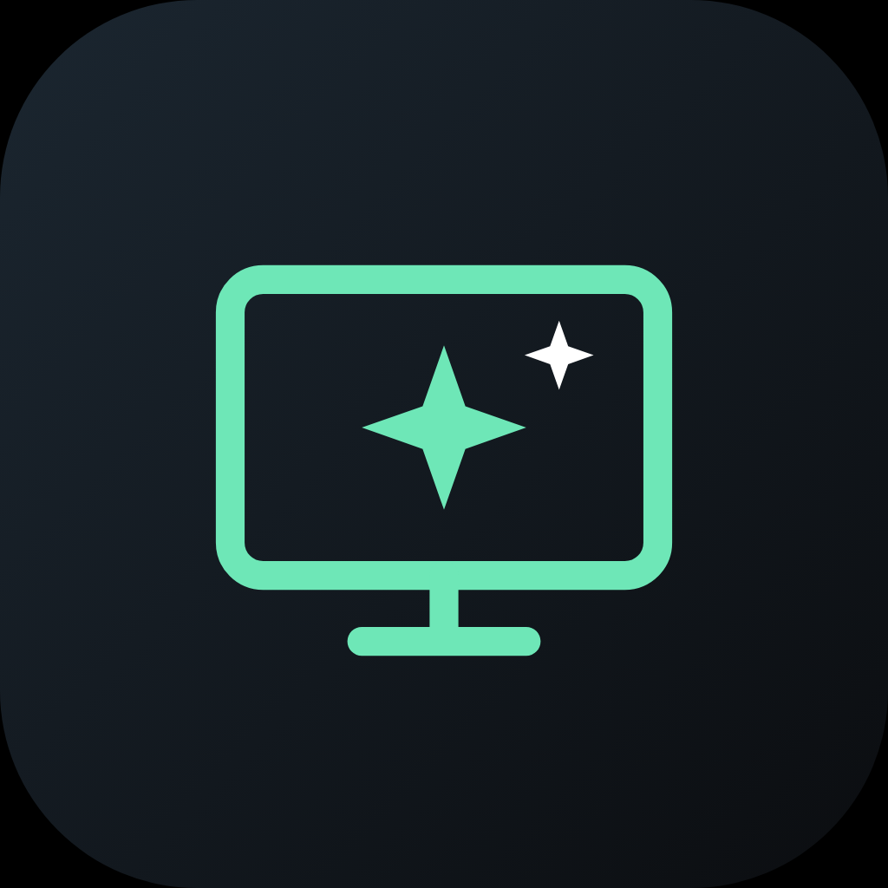

# TV Cleaner (бета)

Чистка Android TV по сети: приложение для телефона на Android и программа для Windows. Без root, ничего не ставится на ТВ.

> **Бета.** Проверена не на всех ТВ, список «мусора» стартовый. Любое изменение откатывается во вкладке «Бэкапы». Используй на свой риск.

## Скачать

Последняя версия: [Releases](../../releases/latest):

- `TVCleaner-Android.apk` — для телефона
- `TVCleaner-Setup.exe` — установщик для Windows
- `TVCleaner-Portable.zip` — Windows без установки (распаковать и запустить `TVCleaner.exe`)

Windows при первом запуске может показать предупреждение SmartScreen (нет платной подписи): «Подробнее» → «Выполнить в любом случае».

## Как пользоваться

1. На ТВ: Настройки → О приложении → 7 раз «Сборка» → Для разработчиков → «Отладка по сети».
2. Телефон или компьютер и ТВ в одной сети.
3. В программе: «ТВ» → «Найти ТВ в сети» → «Подключиться», на ТВ разрешить запрос.
4. «Чистка» → «Просканировать» → «Применить». Перезагрузить ТВ.

## Вкладки

- **ТВ**: подключение и информация об устройстве.
- **Чистка**: «Мусор» (безопасно, отмечено заранее) и «Можно отключить» (с пояснением), кэш, анимации.
- **Лаунчер** (необязательно): замена тяжёлого главного экрана на лёгкий.
- **Бэкапы**: откат удалённого и отключённого.

## Ограничения

- Только порт 5555. Беспроводная отладка Android 11+ с кодом сопряжения не поддерживается.
- Поиск ТВ в сети предполагает маску /24.
- Смена лаунчера не работает на некоторых прошивках.
- Размер кэша по приложениям доступен не на всех ТВ.

## Каталог мусора

`app/src/main/assets/catalog.json`. В `entries` добавляй пакеты, в `neverTouch` — то, что трогать нельзя (строка с точкой на конце — префикс). Присылай свои находки через Issues или Pull request.

## Сборка

Модули: `app` (Android, Kotlin + Compose) и `desktop` (Windows, Compose Desktop). Общий код (модели, скан, чистка) лежит в `app` и подключается в `desktop` автоматически.

GitHub Actions: при каждом коммите в `main` собираются APK, `.exe` и portable-архив и выкладываются одним релизом.

## Лицензия

MIT, см. `LICENSE`.
